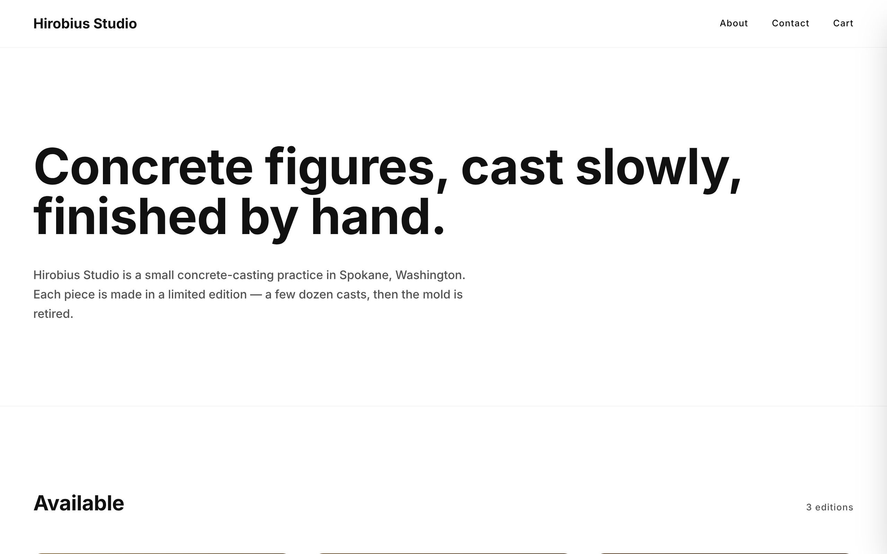

# Hirobius Studio

A storefront for handmade concrete figurines, cast in small editions in Spokane, Washington.



**Live:** https://concrete-rho-six.vercel.app

## Stack

- Vite, React, React Router and Tailwind CSS.
- Design tokens from `@hirobius/design-system`, with a brand overlay in `tenant/`.
- Stripe Checkout for payment. Two Vercel serverless functions in `api/`.
- The catalog is `data/products.json`. Stripe holds the price of each product.
- Hosted on Vercel.

## Run it

```bash
pnpm install
pnpm dev      # http://localhost:5180
pnpm check    # typecheck, tests and the docs check
pnpm build
```

Checkout needs Stripe keys in `.env.local`. See [docs/sale-flow.md](docs/sale-flow.md).

## Structure

- `src/` - the React app: pages, components, cart and catalog helpers.
- `api/` - serverless functions: create a Checkout session, receive the Stripe webhook.
- `data/products.json` - the catalog.
- `tenant/` - the brand token overlay for the design system.
- `scripts/` - catalog, photo, token and launch tools.
- `docs/` - guides, one subject per file.

## Docs

- [Add a product](docs/add-a-product.md)
- [Catalog rules](docs/CATALOG-AUTHORING.md)
- [Product images](docs/PRODUCT-IMAGES.md)
- [Sale flow and local Stripe tests](docs/sale-flow.md)
- [First launch setup](SETUP.md)
- [Go-live runbook](docs/GO-LIVE-RUNBOOK.md)

## Contributing

See [CONTRIBUTING.md](CONTRIBUTING.md). Report a security problem as [SECURITY.md](SECURITY.md) says.

## License

All rights reserved. No license is granted.
